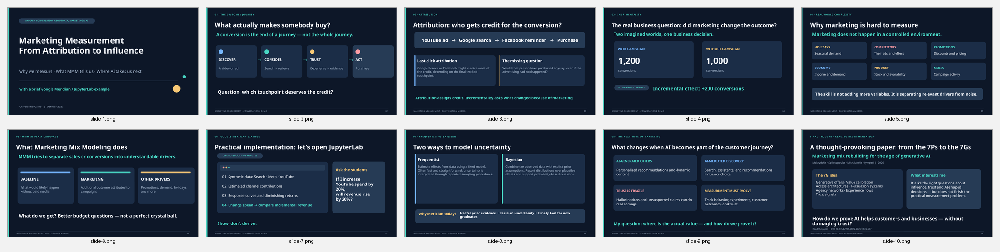
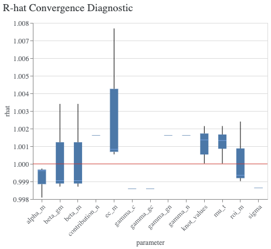

# Marketing Measurement: From Attribution to Influence

### A Google Meridian lecture companion | Synthetic Bayesian Marketing Mix Modeling

**Audience:** students, educators, marketing scientists, analysts, and teams evaluating modern marketing measurement.  
**Presented:** 28 October 2026 · Universidad Galileo student conversation  
**Presenter:** Mohammed Jawhar  
**Format:** introductory slides + JupyterLab walkthrough + short reading notes



## What this project demonstrates

Marketing attribution answers **who receives credit for a conversion**; incrementality asks **what would have happened without the intervention**. Marketing Mix Modeling (MMM) is one approach for estimating the contribution of advertising while accounting for baseline demand and selected business conditions.

This companion project illustrates those distinctions with a **fictional e-commerce business**, **three paid channels** (Google Search, Meta, YouTube), and a beginner-friendly **Bayesian MMM implemented using Google's open-source Meridian**. It includes response curves and a what-if budget simulator.

The repo is an **educational demonstration, not a production-validated causal model**. The provided 156-week dataset is synthetic and does not contain real customer data or personal information.

## Start here

| Resource | Description |
|---|---|
| [Lecture slides (PowerPoint)](slides/Marketing_Measurement_From_Attribution_to_Influence.pptx) · [PDF](slides/Marketing_Measurement_From_Attribution_to_Influence.pdf) | The concise, ten-slide presentation used for the student conversation |
| [Speaker summary](docs/lecture_summary.md) · [two-page handout (PDF)](docs/Marketing_Measurement_Lecture_Handout.pdf) | Slide-by-slide talking points and a concise student-friendly handout |
| [JupyterLab workshop](notebooks/01_meridian_mmm_workshop.ipynb) | Data, assumptions, Meridian model, MCMC diagnostics, response curves, budget scenarios |
| [Synthetic dataset](data/synthetic_weekly_mmm.csv) | 156 weeks, 2023–2025, national e-commerce revenue and media data |
| [Data dictionary](docs/data_dictionary.md) | Units, business interpretation, and methodological cautions |
| [Bayesian vs. frequentist](docs/bayesian_vs_frequentist.md) | Simple coin example, comparison, when to choose each approach |
| [MMM interpretation](docs/reading_meridian_results.md) | Fit, contributions, R-hat, saturation, scenarios, and causal cautions |
| [From 4Ps to 7Ps to 7Gs](docs/marketing_4p_7p_7g.md) | Summary of the proposed AI-era marketing framework and discussion questions |

## Run the workshop on your computer

Python 3.11 is a reasonable starting point; Meridian version compatibility may change. This repository does **not** bundle a trained posterior. Bayesian sampling can take substantial time on a CPU.

```bash
conda create -n meridian-mmm python=3.11 -y
conda activate meridian-mmm
python -m pip install -r requirements.txt
python -m ipykernel install --user --name meridian-mmm --display-name "Python (Meridian MMM)"
jupyter lab
```

Launch JupyterLab from the repository root and open `notebooks/01_meridian_mmm_workshop.ipynb`. The notebook reads `../data/synthetic_weekly_mmm.csv` relative to its own location. **Set `RUN_MODEL = True` only when you want to fit the posterior**, and run the diagnostic/interactive sections after sampling. The widget-based budget controls require a compatible JupyterLab frontend; a plain-Python fallback is included.

> **Technical note:** Meridian's API evolves. The original classroom example used the `DataFrameInputDataBuilder`, `MediaEffects`, and `BudgetOptimizer` APIs. Check the [official Meridian documentation](https://developers.google.com/meridian) if an installed version changes a signature. Results were produced in the lecturer's environment; end-to-end model fitting has **not** been rerun by this repository packaging process.

## Workshop data & honest limitations

- **Dependent variable:** `revenue` (USD), not a conversion-count KPI. Impressions are media-activity inputs; spend is supplied for monetary analysis. No platform-attributed conversions are used as the outcome.
- **Three channel totals (synthetic, entire period):** Search ~$11.28M, Meta ~$7.32M, YouTube ~$4.52M; total **~$23.12M**.
- **Potential confounding:** promotion and consumer demand are included, but observational-data assumptions remain. High in-sample fit does **not** establish causal validity.
- **Response curves:** scenarios hold historical timing/media-price patterns approximately fixed, so they are not experimental guarantees or profit forecasts.
- **Revenue language:** the simulator reports *model-estimated incremental revenue* rather than actual observed revenue or profit. Be careful comparing a revenue lift with the extra cost required to produce it.



*Diagnostic screenshot from the teaching session. Chains appearing to agree (R-hat near 1) do not establish causal correctness.*

## Why teach Bayesian MMM?

Bayesian modeling supports probability distributions over marketing effects, lets reliable experiment evidence inform priors, and can make decision uncertainty explicit. These are advantages for many observational marketing settings. **It does not automatically fix confounding, lack of variation, or model misspecification.** Frequentist regression and regularized MMM remain valuable benchmarks.

## Beyond MMM: AI and marketing strategy

The closing discussion introduces **4Ps → 7Ps → the proposed 7Gs** from *Marketing Mix Rebuilding for the Age of Generative AI: From 7P to 7G Marketing Mix Model* (Makrydakis et al.). This is a **conceptual marketing strategy framework**, not the statistical MMM model shown in the notebook. It prompts a separate question: how do we test whether AI-driven personalization and persuasion actually create value **without harming trust**?

[Read the paper on ResearchGate](https://www.researchgate.net/publication/399671440_Marketing_mix_rebuilding_for_the_age_of_generative_AI_From_7P_to_7G_marketing_mix_model).

## Source and reuse notes

The dataset and teaching material were assembled for this educational example. The slide deck and written notes are original lecture materials; Meridian remains Google's project and is not affiliated with this repository. The referenced research paper is **linked rather than copied**. Please consult its source before attributing specific claims to the authors.

No software license is assigned in this package; the repository owner should select a license appropriate for intended reuse before broad redistribution.

## Publish your own copy

See [PUBLISHING.md](PUBLISHING.md) for a safe, step-by-step GitHub publishing guide.
