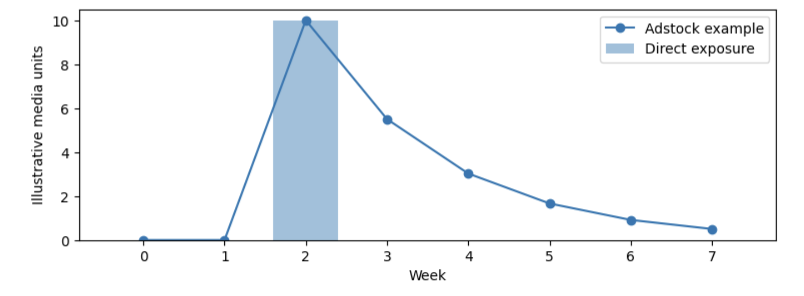
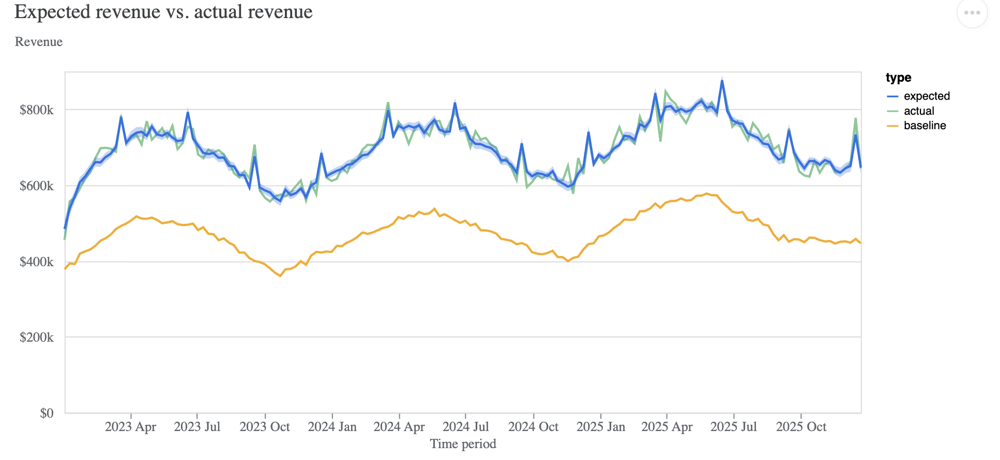
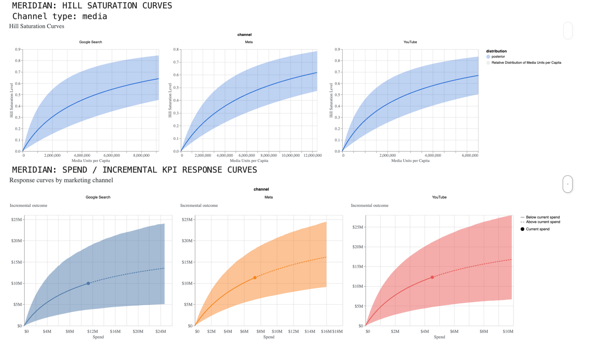
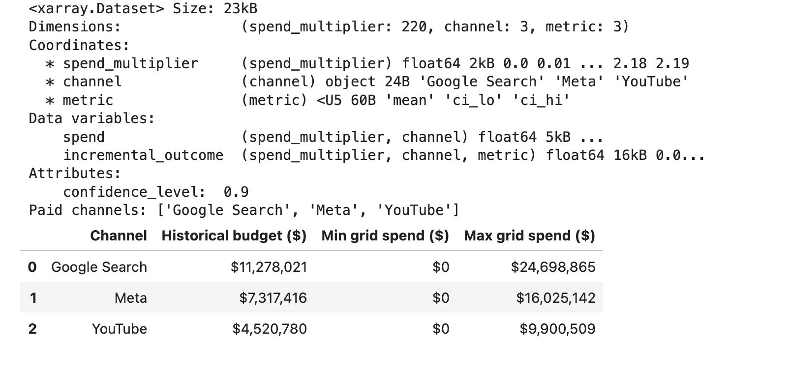
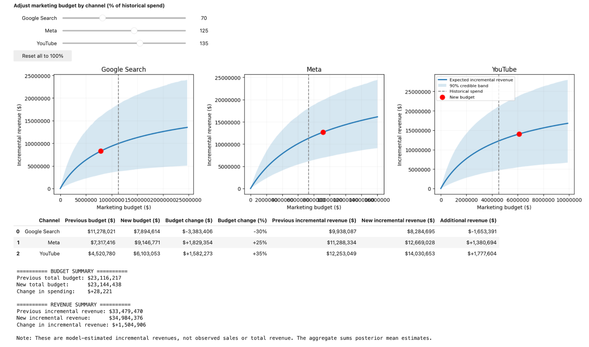

# Meridian MMM — Visual Results

These screenshots accompany the [Marketing Measurement: From Attribution to Influence](../README.md) lecture and its synthetic, three-channel Bayesian MMM workshop. They are **teaching illustrations**, not results from a real advertising campaign. All amounts and model estimates reflect the synthetic demonstration.

## 1. Advertising carryover (adstock)

**What to notice:** An advertising exposure in one week can influence outcomes in later weeks. The illustration shows one pulse of direct exposure and a gradually decaying modeled effect. The actual persistence is model-dependent; this picture is explanatory, not evidence of an estimated real-world decay rate.

## 2. Expected vs. observed revenue

**What to notice:** The expected revenue line tracks synthetic observed weekly revenue closely, while the baseline represents revenue predicted without the modeled paid-media contributions under the model's assumptions. A close **in-sample** fit is useful, but it is not proof that channel effects are causal or that the model will forecast equally well on unseen data.

## 3. Hill saturation and spend-response curves

**What to notice:** The upper charts illustrate **diminishing returns** in media response as exposure rises. The lower charts connect channel spend with modeled incremental revenue. The lines show posterior summaries and the shaded regions express model uncertainty. Different channels can have different slopes and ranges; comparisons should consider both the business units and uncertainty.

## 4. Response-curve data structure

**What to notice:** The `xarray.Dataset` contains **220 spend multipliers**, **three channels** (Google Search, Meta, YouTube), and **three metrics** (`mean`, `ci_lo`, `ci_hi`). Its data variables hold spend and modeled incremental outcome. The dataset attribute `confidence_level: 0.9` indicates the **90% interval** used for the curve summaries.

## 5. Interactive budget reallocation

**What to notice:** This particular *illustrative* scenario sets Google Search to **70%**, Meta to **125%**, and YouTube to **135%** of their historical budgets.

| Synthetic modeled quantity | Historical | Scenario | Change |
|---|---:|---:|---:|
| Total media spend | $23,116,217 | $23,144,438 | +$28,221 |
| Model-estimated incremental revenue | $33,479,470 | $34,984,376 | +$1,504,906 |

The simulator interpolates model-estimated response curves. These figures are **neither observed sales nor guaranteed causal gains**. The apparent revenue uplift is model-dependent, and it does not itself establish incremental profit or account for all costs, feasibility constraints, and uncertainty in the combined budget scenario.

---

### Interpretation cautions

- **Synthetic data only:** No customer-level information, proprietary marketing performance, or real campaign outcome is represented.
- **Observational model:** Bayesian inference does not by itself remove confounding or make a marketing effect identifiable.
- **Uncertainty:** Individual channel interval bands should not be added together to form an aggregate credible interval; a joint posterior calculation is needed.
- **Validation:** Convergence checks, out-of-time testing, sensitivity analysis, and independent lift experiments help assess model reliability.

For definitions, see [Reading Meridian Results](reading_meridian_results.md). For the executable example, see the [workshop notebook](../notebooks/01_meridian_mmm_workshop.ipynb).
